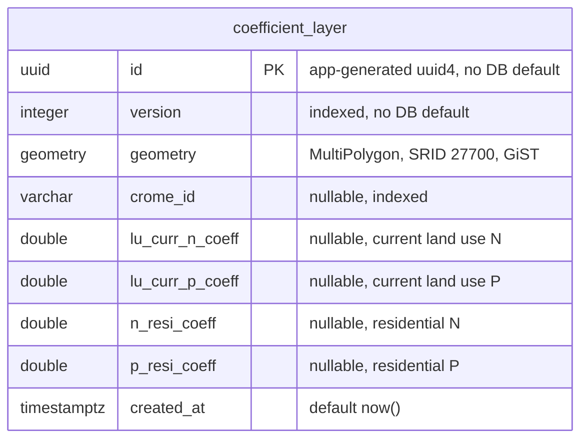
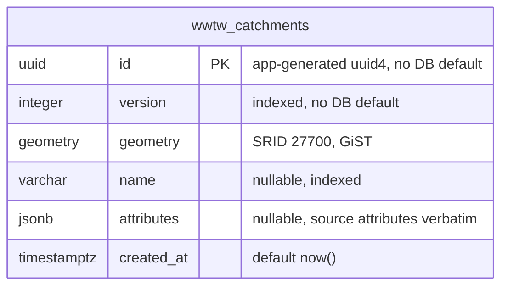

# Reference database ERD

Entity-relationship diagram of the impact-assessor **`nrf_impact`** Postgres
database — the spatial reference layers used for impact assessment, the JSONB
lookup tables, and the audit trail for the S3-driven data sync that loads them.

- **Source:** live `nrf_impact` Postgres (`docker compose` service `postgres`),
  schema `public`, cross-checked against the Alembic revisions under
  `alembic/versions/`.
- **Generated:** 2026-09-16, by the `generate-db-diagram` skill.
- **Scope:** application domain tables only. `alembic_version` and PostGIS
  internals (`spatial_ref_sys`, `geometry_columns`, `geography_columns`) are
  excluded.

This database has **no foreign keys to `nrf_backend`** — the two databases share
a Postgres instance but are otherwise independent. The services talk over HTTP
and SNS/SQS.

Geometry columns are **SRID 27700** (British National Grid) with GiST indexes.
Reference data is **versioned rather than replaced**: a sync loads a new
`version` alongside the old, and `data_active_version` decides which one reads
should use.

## Data management

The foreign keys in this database are `data_load_history.run_id`, `base_prices.edp_id` and the two index keys on `audit_levy_calculations`.

```mermaid
erDiagram
    data_sync_run ||--o{ data_load_history : "audits"
    edps ||--o{ base_prices : "priced by"
    levy_inflation_index |o--o{ audit_levy_calculations : "inflated"

    data_sync_run {
        uuid id PK "app-generated uuid4, no DB default"
        varchar status "running / success / failed"
        varchar data_version "nullable"
        boolean forced "default false"
        timestamptz started_at "default now()"
        timestamptz finished_at "nullable"
        varchar error "nullable"
    }

    data_load_history {
        uuid id PK "app-generated uuid4, no DB default"
        uuid run_id FK "no ON DELETE action"
        varchar table_name "indexed with loaded_at"
        varchar s3_key
        varchar etag
        varchar data_version "nullable"
        integer row_version "nullable, joins the table's version column"
        varchar status "success / reconciled / failed"
        varchar status_detail "nullable"
        timestamptz loaded_at "default now()"
    }

    data_active_version {
        varchar table_name PK "names a reference table, not a FK"
        integer active_version
        timestamptz updated_at "default now()"
    }

    data_rollback_event {
        uuid id PK "app-generated uuid4, no DB default"
        varchar table_name
        integer from_version
        integer to_version
        timestamptz rolled_back_at "default now()"
    }

    lookup_table {
        uuid id PK "app-generated uuid4, no DB default"
        varchar name "unique with version, indexed"
        integer version "unique with name, indexed"
        jsonb data "array of row objects"
        jsonb schema "nullable, column types"
        varchar description "nullable"
        varchar source "nullable"
        varchar license "nullable"
        timestamptz created_at "default now()"
    }

    edps {
        integer id PK "assigned, matches edp_boundary_layer.attributes.EDP_Id"
        varchar name "for readers, not a lookup key"
        date start_date "the EDP's charging year is this date's year"
    }

    base_prices {
        uuid id PK "app-generated uuid4, no DB default"
        numeric base_price "GBP per unit; CHECK over 0, under 10^8, at most 2 dp"
        integer edp_id FK "indexed with effective_from"
        timestamptz created_at "default now()"
        timestamptz effective_from "the price applies from this moment"
        varchar comment
        varchar user_entra_id "who last saved the price"
        varchar user_full_name
        varchar user_email
    }

    audit_levy_calculations {
        uuid id PK "app-generated uuid4, no DB default"
        varchar quote_reference "indexed; NRL-000000"
        integer edp_id
        varchar edp_name
        date edp_start_date
        integer calculator_version
        numeric base_charge_per_unit "numeric(12,4)"
        integer units "dwellings used"
        date calculation_date
        numeric provisional_amount "numeric(12,2)"
        numeric inflation_adjusted_amount "numeric(12,2)"
        uuid levy_charge_id "indexed; base_prices row used, no FK"
        uuid edp_start_year_index_id FK "nullable; levy_inflation_index row, RESTRICT"
        numeric edp_start_year_index_factor "nullable; numeric(10,4)"
        uuid calculation_year_index_id FK "nullable; levy_inflation_index row, RESTRICT"
        numeric calculation_year_index_factor "nullable; numeric(10,4)"
        timestamptz created_at "default now()"
        timestamptz sent_at "nullable; set when nrf-backend accepts the quote PATCH"
    }

    levy_inflation_index {
        uuid id PK "app-generated uuid4, no DB default"
        integer charging_year UK "indexed; one row per year"
        numeric cil_index "numeric(10,4), published RICS CIL Index"
        numeric index_factor "numeric(10,4), RICS CIL Index vs the 2026 base"
        timestamptz created_at "default now()"
    }
```

Reads fall back to `MAX(version)` when `data_active_version` holds no row for a
table, so it only gains one once a reload or rollback has actually run.

The levy tables are maintained by migration and, for `base_prices`, by admins
(NRF2-1351), not by `load_data.py` or data sync, and none is versioned by
`data_active_version`.

`edps` holds each EDP. `base_prices` holds every base price an EDP has had, each
from its own `effective_from`, so a price change is a new row. The assessor
reads the EDP's row with the latest `effective_from` at or before the moment
being priced. The first row is the provisional price the EDP launched with,
seeded by migration `b7d3f9a1c5e2` (EDP 1 at 2675.00 from the EDP start date)
with the user recorded as `system`.

`levy_inflation_index` holds the published RICS CIL Index per charging year and
the factor it derives against the 2026 base (2026 = 1.0000). It is read when the
calculation date falls in a later charging year than the EDP's publication, to
inflation-adjust the provisional amount.

`audit_levy_calculations` holds one audit row per calculation; it is
written by the orchestrator and never truncated by data sync. Each row copies the
values it used and names the `base_prices` row and, when an inflation step
applied, the two `levy_inflation_index` rows they came from (otherwise the index
columns are NULL). The rounded per-unit charges are not stored:
`calculator_version` pins the rounding rule that derives them from
`base_charge_per_unit` and the index factors, and they appear in the audit log
line. Comparing the copy with the current row shows whether a value
was corrected after the event or the wrong row was picked up. The index foreign keys are
`RESTRICT`: an index row that has priced a quote cannot be deleted, so correct
it with a visible update or a new row. `levy_charge_id` has no foreign key,
because an admin can delete a base price that has not taken effect.

## Spatial reference layers

`coefficient_layer` has its own column set — the per-parcel nutrient
coefficients the levy calculation multiplies through, and by far the largest
table (~31.4M polygons).

The remaining **nine** layers share one identical column set. It is drawn once,
on `wwtw_catchments`:

| Table | Holds |
| --- | --- |
| `wwtw_catchments` | Wastewater treatment works catchment polygons |
| `lpa_boundaries` | Local planning authority boundaries |
| `nn_catchments` | Nutrient neutrality catchment polygons |
| `subcatchments` | Sub-catchment polygons |
| `gcn_risk_zones` | Great crested newt risk zones (red/amber/green) |
| `gcn_ponds` | National ponds dataset, for GCN assessment |
| `edp_edges` | Environmental designation polygon edges, for GCN assessment |
| `edp_boundary_layer` | EDP boundary polygons |
| `edp_excluded_areas` | Buffered SSSI exclusion polygons (nutrient EDP) |

These carry no foreign keys — they are independent reference layers, joined
spatially at query time.

## Constraints and indexes worth knowing

| Name | Rule |
| --- | --- |
| `uq_data_sync_run_single_running` | Partial `UNIQUE (status) WHERE status = 'running'` — enforces a single in-flight sync. |
| `uq_lookup_name_version` | `UNIQUE (name, version)` — one row per lookup table per version. |
| `ix_public_coefficient_layer_geom_v1` | Partial GiST over `geometry WHERE version = 1`. **Add an equivalent when loading a new version**, or queries against it lose the index. |
| `ix_data_load_history_table_loaded_at` | `(table_name, loaded_at)` — the provenance lookup. |
| `ck_base_prices_base_price` | `CHECK (base_price > 0 AND base_price < 100000000 AND base_price = round(base_price, 2))` — pounds and pence only. |
| `ix_public_base_prices_edp_id_effective_from` | `(edp_id, effective_from)` — finds the price in force for an EDP at a moment. |
| `uq_levy_inflation_index_year` | `UNIQUE (charging_year)` — one index factor per charging year. |
| `ix_public_audit_levy_calculations_quote_reference` | `(quote_reference)` — fetches the audit trail for a quote. |
| `ix_public_audit_levy_calculations_levy_charge_id` | `(levy_charge_id)` — finds every quote a base price row priced, e.g. after a correction. |
| `fk_audit_levy_calculations_*` | `ON DELETE RESTRICT` to `levy_inflation_index` — an index row that priced a quote cannot be deleted. |
| `ix_public_<layer>_geometry` | GiST on every spatial layer. |

## UUID primary keys have no database default

Every `uuid` primary key here is `default=uuid4` in SQLAlchemy — applied in
**Python**, not by Postgres (see `app/models/db.py`). `information_schema`
therefore reports no default, and a raw `INSERT` that omits the id will fail.
The same applies to `version`, which the models default to `1`.

## Two migration definitions

The schema is defined twice: **Alembic** (`alembic/versions/`, run locally) and a
parallel **Liquibase** changelog (`changelog/`, applied on the deployed
platform). `scripts/check_migration_parity.py` enforces that every Alembic
revision has a matching Liquibase changeset. The live database reflects whichever
ran — this diagram is the same either way.
