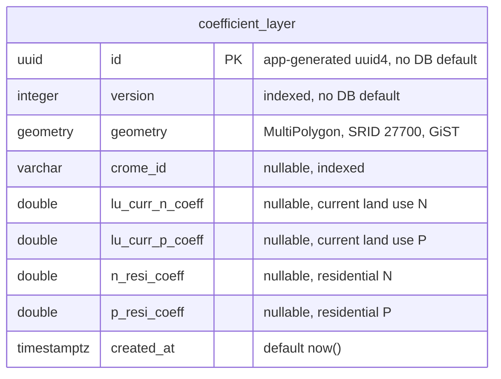
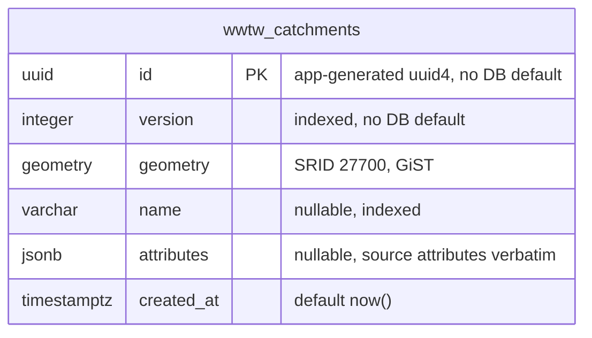

# Reference database ERD

Entity-relationship diagram of the impact-assessor **`nrf_impact`** Postgres
database — the spatial reference layers used for impact assessment, the JSONB
lookup tables, and the audit trail for the S3-driven data sync that loads them.

- **Source:** live `nrf_impact` Postgres (`docker compose` service `postgres`),
  schema `public`, cross-checked against the Alembic revisions under
  `alembic/versions/`.
- **Generated:** 2026-11-19, by the `generate-db-diagram` skill.
- **Scope:** application domain tables only. `alembic_version` and PostGIS
  internals (`spatial_ref_sys`, `geometry_columns`, `geography_columns`) are
  excluded.

This database has **no foreign keys to `nrf_backend`** — the two databases share
a Postgres instance but are otherwise independent. The services talk over HTTP
and SNS/SQS.

Geometry columns are **SRID 27700** (British National Grid) with GiST indexes.
Reference data is **versioned rather than replaced**: a sync loads a new
`version` alongside the old, and `data_active_version` decides which one reads
should use.

## Data management

The foreign keys in this database are `data_load_history.run_id` and `base_prices.edp_id`. `levy_inflation_index_history.inflation_index_id` intentionally has none — a deleted index must keep its history.

```mermaid
erDiagram
    data_sync_run ||--o{ data_load_history : "audits"
    edps ||--o{ base_prices : "priced by"

    data_sync_run {
        uuid id PK "app-generated uuid4, no DB default"
        varchar status "running / success / failed"
        varchar data_version "nullable"
        boolean forced "default false"
        timestamptz started_at "default now()"
        timestamptz finished_at "nullable"
        varchar error "nullable"
    }

    data_load_history {
        uuid id PK "app-generated uuid4, no DB default"
        uuid run_id FK "no ON DELETE action"
        varchar table_name "indexed with loaded_at"
        varchar s3_key
        varchar etag
        varchar data_version "nullable"
        integer row_version "nullable, joins the table's version column"
        varchar status "success / reconciled / failed"
        varchar status_detail "nullable"
        timestamptz loaded_at "default now()"
    }

    data_active_version {
        varchar table_name PK "names a reference table, not a FK"
        integer active_version
        timestamptz updated_at "default now()"
    }

    data_rollback_event {
        uuid id PK "app-generated uuid4, no DB default"
        varchar table_name
        integer from_version
        integer to_version
        timestamptz rolled_back_at "default now()"
    }

    lookup_table {
        uuid id PK "app-generated uuid4, no DB default"
        varchar name "unique with version, indexed"
        integer version "unique with name, indexed"
        jsonb data "array of row objects"
        jsonb schema "nullable, column types"
        varchar description "nullable"
        varchar source "nullable"
        varchar license "nullable"
        timestamptz created_at "default now()"
    }

    edps {
        integer id PK "assigned, matches edp_boundary_layer.attributes.EDP_Id"
        varchar name "for readers, not a lookup key"
        date start_date "the EDP's charging year is this date's year"
    }

    base_prices {
        integer id PK "identity, auto-incrementing"
        numeric_10_2 base_price "GBP per unit; CHECK over 0, not NaN"
        integer edp_id FK "indexed with effective_from"
        timestamptz created_at "default now()"
        timestamptz effective_from "the price applies from this moment"
        varchar comment "max 500; CHECK not blank"
        varchar requestor "nullable, max 255; who asked for the change; CHECK not blank"
        varchar jira_ticket "nullable, max 20; CHECK NRF2-1234 format"
        varchar staff_id "max 36 (GUID, the identity provider id); staff member who last saved the price"
        varchar staff_full_name "max 255"
        varchar staff_email "max 254"
    }

    levy_inflation_index {
        uuid id PK "app-generated uuid4, no DB default"
        integer charging_year UK "indexed; one row per year"
        numeric cil_index "numeric(10,4), published RICS CIL Index"
        numeric index_factor "numeric(10,4), RICS CIL Index vs the 2026 base"
        timestamptz created_at "default now()"
        varchar comment "why the row was saved; not blank"
        varchar staff_id "Entra oid of the admin who saved it"
        varchar staff_full_name
        varchar staff_email
        varchar requestor "nullable, max 255; who asked for the change; CHECK not blank"
        varchar jira_ticket "nullable, max 20; CHECK NRF2-1234 format"
    }

    levy_inflation_index_history {
        uuid id PK "app-generated uuid4, no DB default"
        uuid inflation_index_id "indexed; names the added row, no FK by design"
        integer charging_year
        numeric cil_index "numeric(10,4), as added"
        numeric index_factor "numeric(10,4), as added"
        varchar comment "max 500; CHECK not blank"
        varchar staff_id "max 36; admin who added the row"
        varchar staff_full_name "max 255"
        varchar staff_email "max 254"
        varchar requestor "nullable, max 255; who asked for the change"
        varchar jira_ticket "nullable, max 20"
        timestamptz created_at "default now()"
    }

    audit_model_results {
        uuid id PK "app-generated uuid4, no DB default"
        varchar status "success / failed"
        varchar nrl_reference "indexed; NRL-000000"
        varchar assessment_type "nutrient / gcn"
        varchar model_version "the model's git version"
        jsonb model_output "nullable; the model's output on success"
        varchar error_details "nullable; why it failed"
        timestamptz created_at "default now()"
    }
```

Reads fall back to `MAX(version)` when `data_active_version` holds no row for a
table, so it only gains one once a reload or rollback has actually run.

The levy tables are maintained by migration and, for `base_prices` (NRF2-1351)
and `levy_inflation_index` (NRF2-1348), by admins, not by `load_data.py` or
data sync, and none is versioned by `data_active_version`.

`edps` holds each EDP. `base_prices` holds every base price an EDP has had, each
from its own `effective_from`, so a price change is a new row. The assessor
reads the EDP's row with the latest `effective_from` at or before the moment
being priced. The first row is the provisional price the EDP launched with,
seeded by migration `b7d3f9a1c5e2` (EDP 1 at 2675.00 from 00:00 UTC on the EDP
start date) with the user recorded as `system`. `levy_charges` was dropped, not
converted. All
timestamps are stored and passed as UTC; the charging year is the UTC year.

`levy_inflation_index` holds the published RICS CIL Index per charging year and
the factor it derives against the 2026 base (2026 = 1.0000): the factor is
`cil_index / the 2026 row's cil_index`, quantized to 4 dp half-up. A row is in
force for the whole of its charging year — the effective date is 1 January
00:00 UTC of `charging_year`, derived, not stored — and it is read when the
calculation date falls in a later charging year than the EDP's publication, to
inflation-adjust the provisional amount. Migration `2ddd520a2291` seeds the
2026 base row and the 2027 charging-schedule row (factor 1.0000: the first
year's inflation is built into the charging schedule) with the user recorded
as `system`; later years are added by NRF Digital admins through the admin
frontend one row per year, each recording who saved it, when and why. A row
whose charging year has begun cannot be changed or deleted.

`levy_inflation_index_history` records **additions only**: one row per index
added, written in the same transaction as the add, copying the values as saved.
Amendments and deletions are not recorded, and the table started empty (the
seeded rows predate it). `inflation_index_id` has no foreign key on purpose, so
deleting an index does not take its history with it.

Levy calculations are not recorded in this database. Each calculation is sent
to nrf-backend, which keeps the history in `quote_edp_results`: the values it
used, the `base_prices` row (`levy_charge_id`) and, when an inflation step
applied, the two `levy_inflation_index` rows it came from. The rounded per-unit
charges are not stored: `calculator_version` pins the rounding rule that
derives them from the base charge per unit and the index factors.

`audit_model_results` is the assessment-run audit: one row per
`process_job` attempt, so a redelivered job records one row per try. On success
`model_output` holds the model's output as JSONB; on failure `error_details`
holds why. `model_version` pins the model's git version the run used. It is
written by the orchestrator and never truncated by data sync.

## Spatial reference layers

`coefficient_layer` has its own column set — the per-parcel nutrient
coefficients the levy calculation multiplies through, and by far the largest
table (~31.4M polygons).

The remaining **nine** layers share one identical column set. It is drawn once,
on `wwtw_catchments`:

| Table | Holds |
| --- | --- |
| `wwtw_catchments` | Wastewater treatment works catchment polygons |
| `lpa_boundaries` | Local planning authority boundaries |
| `nn_catchments` | Nutrient neutrality catchment polygons |
| `subcatchments` | Sub-catchment polygons |
| `gcn_risk_zones` | Great crested newt risk zones (red/amber/green) |
| `gcn_ponds` | National ponds dataset, for GCN assessment |
| `edp_edges` | Environmental designation polygon edges, for GCN assessment |
| `edp_boundary_layer` | EDP boundary polygons |
| `edp_excluded_areas` | Buffered SSSI exclusion polygons (nutrient EDP) |

These carry no foreign keys — they are independent reference layers, joined
spatially at query time.

## Constraints and indexes worth knowing

| Name | Rule |
| --- | --- |
| `uq_data_sync_run_single_running` | Partial `UNIQUE (status) WHERE status = 'running'` — enforces a single in-flight sync. |
| `uq_lookup_name_version` | `UNIQUE (name, version)` — one row per lookup table per version. |
| `ix_public_coefficient_layer_geom_v1` | Partial GiST over `geometry WHERE version = 1`. **Add an equivalent when loading a new version**, or queries against it lose the index. |
| `ix_data_load_history_table_loaded_at` | `(table_name, loaded_at)` — the provenance lookup. |
| `ck_base_prices_base_price` | `CHECK (base_price > 0 AND base_price <> 'NaN')` — positive; the column is `numeric(10, 2)`, so pounds and pence up to 99999999.99. |
| `ck_base_prices_comment_not_blank` | `CHECK (comment ~ '\S')` — a comment needs at least one non-whitespace character. |
| `ix_public_base_prices_edp_id_effective_from` | `UNIQUE (edp_id, effective_from)` — one price change per moment; finds the price in force for an EDP at a moment. |
| `ck_base_prices_requestor_not_blank` / `ck_levy_inflation_index_requestor_not_blank` | `CHECK (requestor ~ '\S')` — nullable, but never blank when set. |
| `ck_base_prices_jira_ticket_format` / `ck_levy_inflation_index_jira_ticket_format` | `CHECK (jira_ticket ~ '^NRF2-[0-9]+$')` — nullable, but must be a Jira key when set. |
| `uq_levy_inflation_index_year` | `UNIQUE (charging_year)` — one index factor per charging year. |
| `ck_levy_inflation_index_cil_index` | `CHECK (cil_index > 0 AND cil_index <> 'NaN')` — the published index is positive. |
| `ck_levy_inflation_index_comment_not_blank` | `CHECK (comment ~ '\S')` — a comment needs at least one non-whitespace character. |
| `ck_levy_inflation_index_history_comment_not_blank` | `CHECK (comment ~ '\S')` — same rule on the history copy. |
| `ix_levy_inflation_index_history_inflation_index_id` | `(inflation_index_id)` — finds when an index was added and by whom. |
| `ix_public_audit_model_results_nrl_reference` | `(nrl_reference)` — fetches the assessment-run audit trail for a quote. |
| `ix_public_<layer>_geometry` | GiST on every spatial layer. |

## UUID primary keys have no database default

Every `uuid` primary key here is `default=uuid4` in SQLAlchemy — applied in
**Python**, not by Postgres (see `app/models/db.py`). `information_schema`
therefore reports no default, and a raw `INSERT` that omits the id will fail.
The same applies to `version`, which the models default to `1`.

## Two migration definitions

The schema is defined twice: **Alembic** (`alembic/versions/`, run locally) and a
parallel **Liquibase** changelog (`changelog/`, applied on the deployed
platform). `scripts/check_migration_parity.py` enforces that every Alembic
revision has a matching Liquibase changeset. The live database reflects whichever
ran — this diagram is the same either way.
